<div align="center">


<h3>Companion packs for GBADuo: what your game shows on the bottom screen.</h3>

<p>
  <a href="https://github.com/khumam/gba-duo-companions/releases/latest"></a>
  <a href="https://github.com/khumam/gba-duo/releases/latest"></a>
</p>

<p>
  <strong><a href="https://github.com/khumam/gba-duo-companions/releases/latest">Download packs</a></strong>
  · <strong><a href="#packs">Packs</a></strong>
  · <strong><a href="#make-a-pack">Make a pack</a></strong>
  · <strong><a href="https://github.com/khumam/gba-duo">GBADuo app</a></strong>
  · <strong><a href="https://github.com/khumam/gba-duo-companion-simulator">Simulator</a></strong>
</p>

</div>

[GBADuo](https://github.com/khumam/gba-duo) plays Game Boy Advance, Game Boy Color
and Game Boy games on the top screen of a dual-screen handheld like the AYN Thor. The
bottom screen shows a **companion pack**: a layout, CSS and a Lua script that read the
game's memory as you play. This repo holds the packs, one folder each.

## Gallery

Every pack copies one screen of its game (the Bag window, the pause menu, the save list) and keeps it live from the game's memory. Tap a tile to open it, and in many packs change the game from the second screen. A few of the 12 shown here; every pack has an overview sheet in [`overview/`](https://github.com/khumam/gba-duo-companions/tree/main/overview).

<table>
<tr>
<td align="center" width="33%"><a href="https://github.com/khumam/gba-duo-companions/tree/main/pokemon-firered-companion">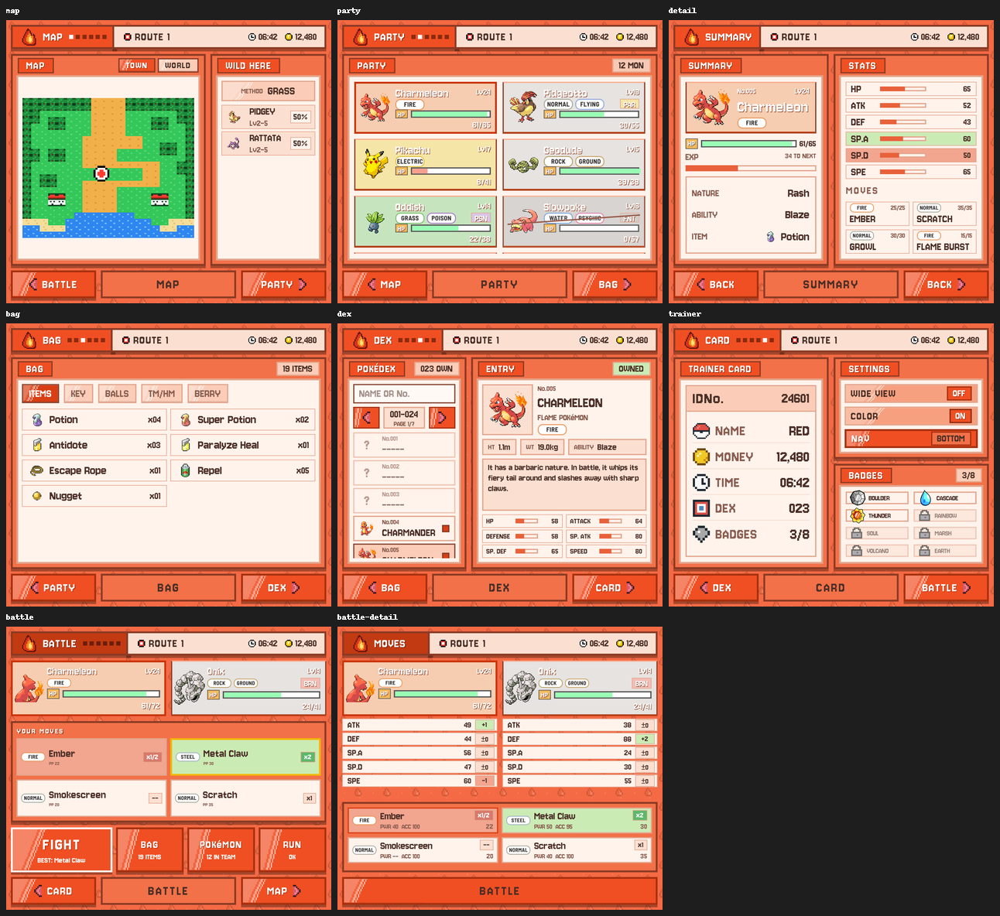</a><br><sub><b>Pokémon FireRed</b></sub></td>
<td align="center" width="33%"><a href="https://github.com/khumam/gba-duo-companions/tree/main/pokemon-emerald-companion">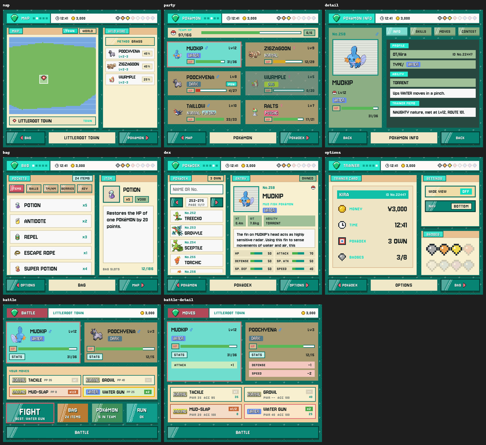</a><br><sub><b>Pokémon Emerald</b></sub></td>
<td align="center" width="33%"><a href="https://github.com/khumam/gba-duo-companions/tree/main/golden-sun-companion">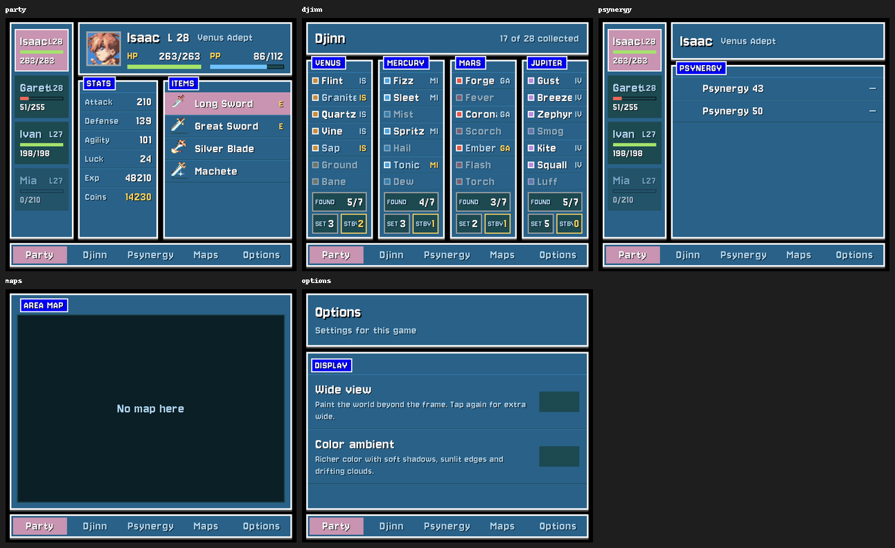</a><br><sub><b>Golden Sun</b></sub></td>
</tr>
<tr>
<td align="center" width="33%"><a href="https://github.com/khumam/gba-duo-companions/tree/main/zelda-the-minish-cap-companion">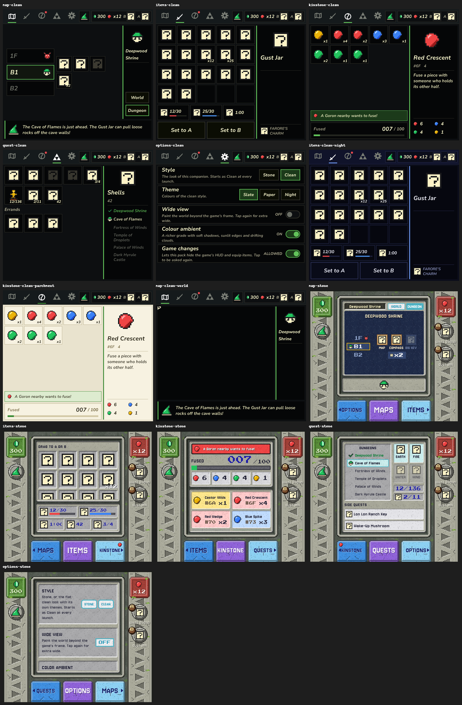</a><br><sub><b>Zelda: The Minish Cap</b></sub></td>
<td align="center" width="33%"><a href="https://github.com/khumam/gba-duo-companions/tree/main/metroid-fusion-companion">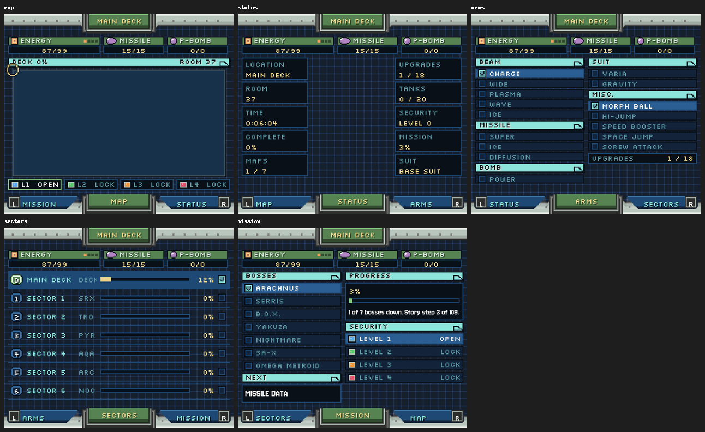</a><br><sub><b>Metroid Fusion</b></sub></td>
<td align="center" width="33%"><a href="https://github.com/khumam/gba-duo-companions/tree/main/castlevania-aria-of-sorrow-companion">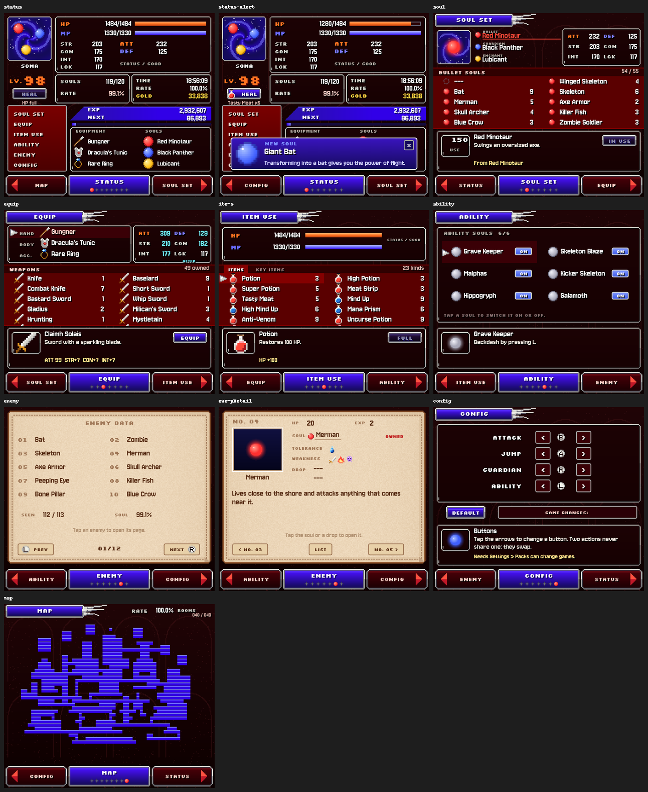</a><br><sub><b>Castlevania: Aria of Sorrow</b></sub></td>
</tr>
<tr>
<td align="center" width="33%"><a href="https://github.com/khumam/gba-duo-companions/tree/main/fire-emblem-the-sacred-stones-companion">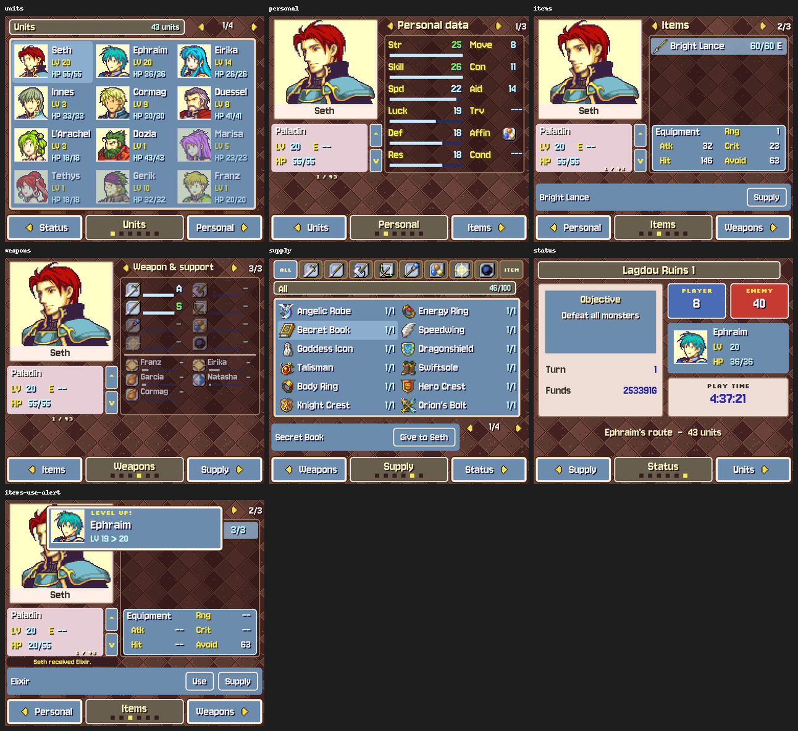</a><br><sub><b>Fire Emblem: The Sacred Stones</b></sub></td>
<td align="center" width="33%"><a href="https://github.com/khumam/gba-duo-companions/tree/main/mario-luigi-superstar-saga-companion">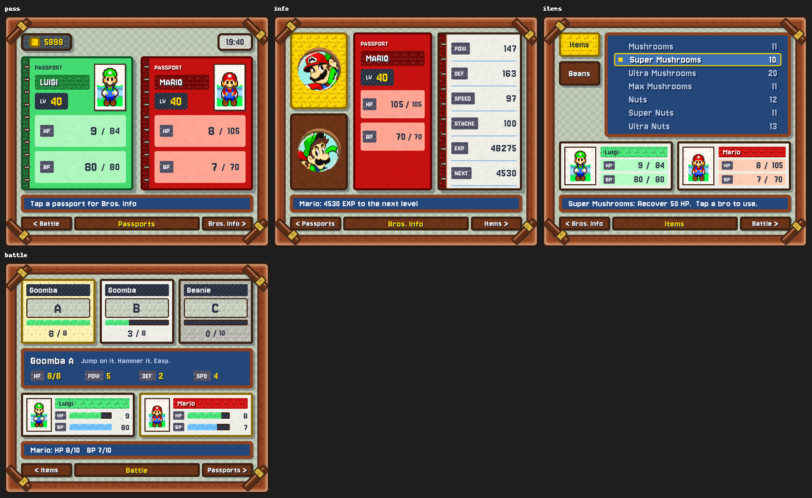</a><br><sub><b>Mario & Luigi: Superstar Saga</b></sub></td>
<td align="center" width="33%"><a href="https://github.com/khumam/gba-duo-companions/tree/main/harvest-moon-fomt-companion">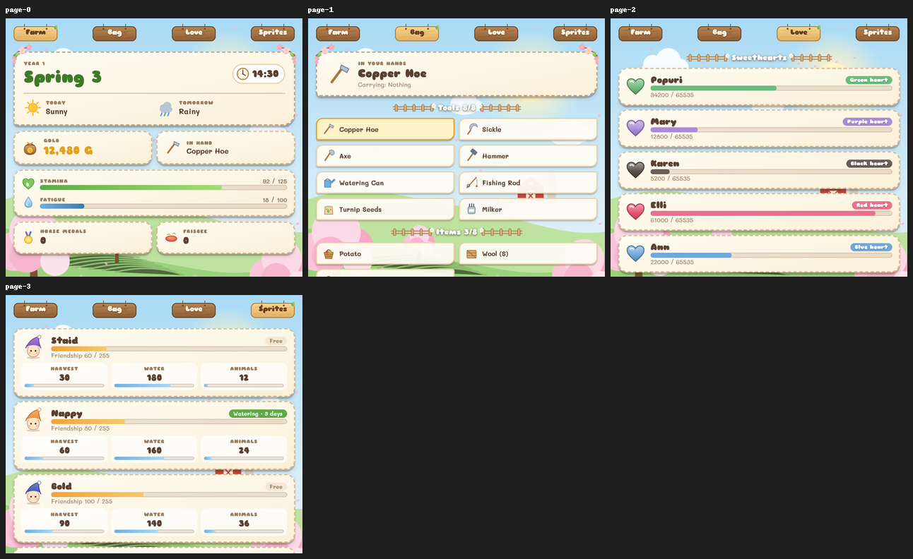</a><br><sub><b>Harvest Moon: FoMT</b></sub></td>
</tr>
<tr>
<td align="center" width="33%"><a href="https://github.com/khumam/gba-duo-companions/tree/main/mother-3-companion">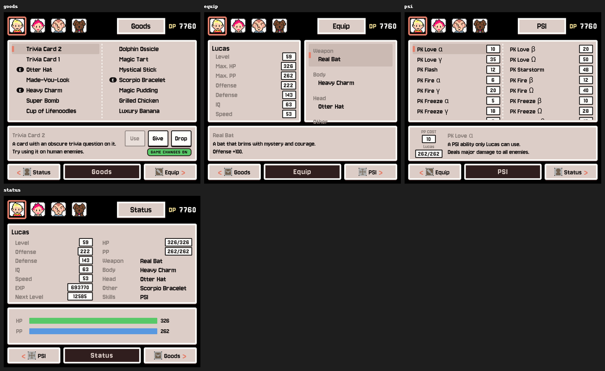</a><br><sub><b>Mother 3</b></sub></td>
<td align="center" width="33%"><a href="https://github.com/khumam/gba-duo-companions/tree/main/zelda-a-link-to-the-past-companion">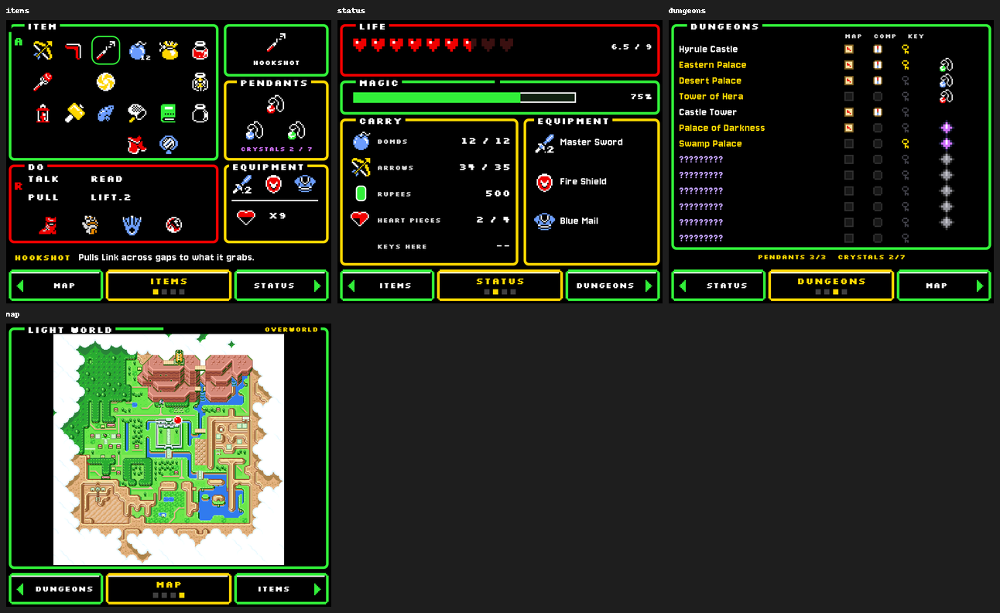</a><br><sub><b>Zelda: A Link to the Past</b></sub></td>
<td align="center" width="33%"><a href="https://github.com/khumam/gba-duo-companions/tree/main/final-fantasy-vi-advance-companion">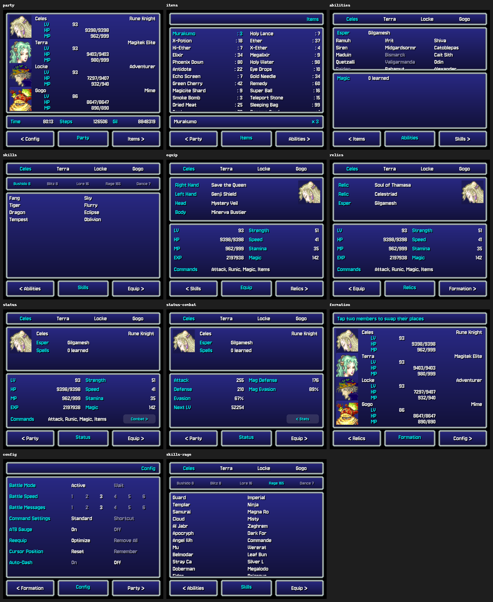</a><br><sub><b>Final Fantasy VI Advance</b></sub></td>
</tr>
</table>

## Install a pack

1. Download the pack's `.zip` from the
   [latest release](https://github.com/khumam/gba-duo-companions/releases/latest) on the device.
2. In GBADuo, tap **⋮** next to the game, then **Import pack…**, and pick the zip.
3. Start the game. The companion shows on the bottom screen.

Each game remembers its pack; change it any time from the same **⋮** menu.

**Other regions.** A pack lists the game code it was mapped for (`BPRE` is FireRed USA).
GBADuo also offers it for the other regions and revisions of the same game (`BPRJ`, `BPRD`, ...):
pick it as usual and GBADuo warns that the pack is mapped for another region, so it may glitch or show
wrong data. A pack that pins a ROM checksum (`crc32`, like the hack packs) is only offered for that ROM.
If an other-region pack misbehaves, please open an issue with the game code and what you saw. This needs
GBADuo **v1.0.1**.
Most packs need GBADuo **v0.1.3** or newer; the Metroid and Oracle of Ages packs need **v0.1.8**. The **WIDE** button (Pokémon FireRed and LeafGreen, The Minish Cap, Golden Sun) paints the game's world beside the picture and needs **v0.1.9**, **v0.1.10** for The Minish Cap, or **v0.1.11** for Golden Sun. The Dragon Ball Z: Legacy of Goku II, Pokémon Monomyth, Light Platinum, Unbound, Golden Sun: The Lost Age, Castlevania, Fire Emblem, Harvest Moon, Mother 3 and A Link to the Past packs need **v0.1.15**.

## Packs

Each pack is a folder; the zip name is `<pack>-<version>.zip` on the
[latest release](https://github.com/khumam/gba-duo-companions/releases/latest).

### Pokémon

| Pack | Game | Game codes | Pages | Version | Notes |
|---|---|---|---|---|---|
| [`pokemon-firered-companion`](pokemon-firered-companion) | Pokémon FireRed | `BPRE` | Map, Party, Bag, Dex list, Card, Battle (with controls) | 3.1.0 | The Emerald companion's console layout in a soft red pastel palette: Pokédex list with entries, interactive battle buttons and move list, tap a Pokémon for its details. |
| [`pokemon-leafgreen-companion`](pokemon-leafgreen-companion) | Pokémon LeafGreen | `BPGE` | Map, Party, Bag, Dex list, Card, Battle (with controls) | 2.1.0 | The same console layout in a soft green pastel palette. |
| [`pokemon-emerald-companion`](pokemon-emerald-companion) | Pokémon Emerald | `BPEE` | Bag, Map, Party, Detail, Dex, Options, Battle | 1.1.0 | The trainer console: header band, windows, a bottom ring bar; Pokédex list, contest condition, interactive battle buttons. |
| [`pokemon-ruby-companion`](pokemon-ruby-companion) | Pokémon Ruby | `AXVE` | Bag, Map, Party, Detail, Dex, Options, Battle | 1.1.0 | The Emerald console ported to Ruby (USA 1.0), in a red pastel palette. |
| [`pokemon-sapphire-companion`](pokemon-sapphire-companion) | Pokémon Sapphire | `AXPE` | Bag, Map, Party, Detail, Dex, Options, Battle | 1.1.0 | The same console for Sapphire (USA 1.0), in a blue pastel palette. |
| [`pokemon-light-platinum-companion`](pokemon-light-platinum-companion) | Pokémon Light Platinum | `AXVE` (CRC `4b04b0c7`) | Bag, Map, Party, Detail, Dex, Options, Battle | 0.2.0 | The Emerald console on the Ruby based hack: every Ruby address holds, species names found in the ROM, Black/White sprites for the newer Pokémon. Side docks and a **NAV** setting, WIDE and COLOR. See [NOTES](pokemon-light-platinum-companion/NOTES.md). |
| [`pokemon-unbound-companion`](pokemon-unbound-companion) | Pokémon Unbound | `BPRE` (CRC `d8900587`, 2.1.1) | Map, Party, Bag, Dex, Card, Battle | 0.2.0 | The FireRed console for the CFRU based hack: plain party data, its repointed sprite tables read from the live sprites, Wide view with NPC markers. Side docks and a **NAV** setting. See [NOTES](pokemon-unbound-companion/NOTES.md). |
| [`pokemon-monomyth-companion`](pokemon-monomyth-companion) | Pokémon Monomyth | `MONE` (CRC `8441c61b`) | Bag, Map, Party, Detail, Dex, Options, Battle | 0.3.0 | The Emerald console on the Emerald based decomp hack: town picture and wild encounters, party and live battle from its own data tables (species, moves, abilities, items), 405 front and back sprites, a species book. Needs **GBADuo v0.1.15**. See [NOTES](pokemon-monomyth-companion/NOTES.md). |
| [`pokemon-emerald-seaglass-companion`](pokemon-emerald-seaglass-companion) | Pokémon Emerald Seaglass | `BPEE` (CRC `14465a33`) | Party, Summary, Bag, Dex, Trainer, Diag | 0.1.0 | Community pack by **angry-dad**. Seaglass v3.0 in its own GBC look: cream windows with slate frames, the party list with type chips, a summary with stats and moves, the bag's four pockets, a 386-species dex browser and a trainer card. Reads the ROM and the save only, nothing is written. Not checked by the maintainer yet. See [NOTES](pokemon-emerald-seaglass-companion/NOTES.md). |

### Metroid

| Pack | Game | Game codes | Pages | Version | Notes |
|---|---|---|---|---|---|
| [`metroid-zero-mission-companion`](metroid-zero-mission-companion) | Metroid: Zero Mission | `BMXE` `BMXP` `BMXJ` | Map, Status, Sectors, Log | 1.0.5 | The game's pause screen. Your explored map centered on Samus, her suit with the beams and gear you own (tap one to switch it on or off), area progress, boss targets and recovered tanks. Needs **GBADuo v0.1.8** and, for the switches, **Settings > Packs can change games**. See [NOTES](metroid-zero-mission-companion/NOTES.md). |
| [`advance-wars-companion`](advance-wars-companion) | Advance Wars | `AWRE` | Home, Units, Unit, Map, Armies, Guide, Log, Options | 0.1.1 | The day, funds and every army's units with HP, fuel and ammo, a map of the battlefield, a unit guide from the ROM's own table, an event log, and a movable navigation bar. |
| [`final-fantasy-tactics-advance-companion`](final-fantasy-tactics-advance-companion) | Final Fantasy Tactics Advance | `AFXE` | Clan, Unit, Skills, Jobs, Top, Compare, Battle, Stats, Options | 0.1.1 | The clan roster with stats worked out from base values, gear and jobs (checked against the game's own screens), equipped abilities, a gear compare, the battle's foes and the Day's laws, and a movable navigation bar. Ships no game graphics. |
| [`dragon-ball-z-legacy-of-goku-2-companion`](dragon-ball-z-legacy-of-goku-2-companion) | Dragon Ball Z: The Legacy of Goku II | `ALFE` | Journal, Status, Items, Options | 0.4.0 | The game's pause menu. Your party with live HP, EP, STR / POW / END, level and EXP, techniques, the items you carry with pictures and descriptions, and your active and finished quests. **Wide view** (Options page) paints the map around the game's picture, draws sprites that stick out of the frame, and stops at the map's edge; needs **GBADuo v0.1.15**. See [NOTES](dragon-ball-z-legacy-of-goku-2-companion/NOTES.md). |
| [`final-fantasy-vi-advance-companion`](final-fantasy-vi-advance-companion) | Final Fantasy VI Advance | `BZ6E` | Party, Items, Abilities, Equip, Relics, Status, Formation, Config | 0.2.1 | The game's whole pause menu in a loop (left / right buttons): your party, every item, Espers and Magic, gear, relics, base stats and commands, the party order (tap two to swap) and the Config settings (tap to change; needs **Packs can change games**). See [NOTES](final-fantasy-vi-advance-companion/NOTES.md). |
| [`mario-luigi-superstar-saga-companion`](mario-luigi-superstar-saga-companion) | Mario & Luigi: Superstar Saga | `A88E` | Passports, Bros. Info, Items | 0.2.1 | The game's Select menu: both brothers' passports (level, HP, BP, coins, play time), Bros. Info (POW, DEF, SPEED, STACHE, EXP and what is left to the next level) and your items and beans with their descriptions. Equipment, key items and the map are not mirrored yet. See [NOTES](mario-luigi-superstar-saga-companion/NOTES.md). |
| [`metroid-fusion-companion`](metroid-fusion-companion) | Metroid Fusion | `AMTE` `AMTP` `AMTJ` | Map, Status, Arms, Sectors, Mission | 2.0.5 | The game's pause screen. Live map, Samus on her grid, every upgrade, sector progress, bosses, security hatches and your next objective. Game art is drawn from the US ROM; other regions show a text-only waiting screen. Needs **GBADuo v0.1.8**. See [NOTES](metroid-fusion-companion/NOTES.md). |

### Castlevania

| Pack | Game | Game codes | Pages | Version | Notes |
|---|---|---|---|---|---|
| [`castlevania-aria-of-sorrow-companion`](castlevania-aria-of-sorrow-companion) | Castlevania: Aria of Sorrow | `A2CE` | Status, Soul, Equip, Items, Ability, Enemy, Config, Map | 0.1.0 | The pause menu in a loop (left / right plates): status with tappable menu and equipment, the soul set, equipment, items, abilities, enemy data and the castle map. Equip, set souls and use items from the second screen (needs **Settings > Packs can change games**). Not checked on a device yet. See [NOTES](castlevania-aria-of-sorrow-companion/NOTES.md). |
| [`castlevania-circle-of-the-moon-companion`](castlevania-circle-of-the-moon-companion) | Castlevania: Circle of the Moon | `AAME` | Status, DSS, Items, Cards, Magic, Config, Map | 0.1.0 | The pause menu in a loop: status with the DSS combo and gear, the DSS card list, items, cards, magic, config and the castle map. Not checked on a device yet. See [NOTES](castlevania-circle-of-the-moon-companion/NOTES.md). |
| [`castlevania-harmony-of-dissonance-companion`](castlevania-harmony-of-dissonance-companion) | Castlevania: Harmony of Dissonance | `ACHE` | Map, Status, Equip, Items, Books, Relics, Config | 0.1.0 | The SELECT castle map (Castle A and B) and the pause menu: equipment, items, spell books, relics and the config buttons. Not checked on a device yet. See [NOTES](castlevania-harmony-of-dissonance-companion/NOTES.md). |
| [`castlevania-hod-companion`](castlevania-hod-companion) | Castlevania: Harmony of Dissonance (second pack, by Ress) | `ACHE` | Status, Items, Magic, Battle, Book, Map | 1.0.0 | Styled after the game's pause menu; every picture and text is read from your own ROM. Live enemy HP bars and boss card, the Encyclopedia and the castle map. Author: **Ress**. See its [README](castlevania-hod-companion/README.md). |

### Fire Emblem

| Pack | Game | Game codes | Pages | Version | Notes |
|---|---|---|---|---|---|
| [`fire-emblem-companion`](fire-emblem-companion) | Fire Emblem | `AE7Y` (Europe) | Units, Personal, Items, Weapons, Supply, Status | 0.1.0 | The game's unit screens (`< title > n/3`): every unit with stats, personal data, items, weapon ranks, the convoy and the chapter status. Portraits are read from your ROM. Only the European cartridge. Not checked on a device yet. See [NOTES](fire-emblem-companion/NOTES.md). |
| [`fire-emblem-the-sacred-stones-companion`](fire-emblem-the-sacred-stones-companion) | Fire Emblem: The Sacred Stones | `BE8E` | Units, Personal, Items, Weapons, Supply, Status | 0.1.0 | The same unit screens for The Sacred Stones, portraits read from your ROM. Only the USA cartridge. Not checked on a device yet. See [NOTES](fire-emblem-the-sacred-stones-companion/NOTES.md). |

### Zelda

| Pack | Game | Game codes | Pages | Version | Notes |
|---|---|---|---|---|---|
| [`zelda-minish-cap-companion`](zelda-the-minish-cap-companion) | The Minish Cap | `BZME` `BZMP` `BZMJ` | Map, Items, Kinstone, Quest | 3.2.2 | *Minish-OS*: wood and leather panels with stone item sockets. The world map, item icons, Link and the title logo are drawn from your ROM. Tap Ezlo for a hint. Wide view draws nearby enemies and NPCs in the margins and hides the HUD over the picture (the pack asks first); a **COLOR** button needs **GBADuo v0.1.13**. See [NOTES](zelda-the-minish-cap-companion/NOTES.md). |
| [`zelda-oracle-of-ages-companion`](zelda-oracle-of-ages-companion) | Oracle of Ages | `CGB-AZ8E` `CGB-AZ8P` `CGB-AZ8J` | Items, Map, Seeds, Rings, Status | 0.1.3 | Early version in the game's own subscreen style. Era maps that dim unvisited rooms, seeds, all 64 rings, hearts and essences. Needs **GBADuo v0.1.8**. See [NOTES](zelda-oracle-of-ages-companion/NOTES.md). |
| [`zelda-a-link-to-the-past-companion`](zelda-a-link-to-the-past-companion) | The Legend of Zelda: A Link to the Past | `AZLE` | Items, Status, Dungeons, Map | 0.1.0 | The GBA item screen: items grid, hearts, magic, bombs and arrows, rupees, dungeon progress and the overworld map. Read-only. Not checked on a device yet. See [NOTES](zelda-a-link-to-the-past-companion/NOTES.md). |

### Other games

| Pack | Game | Game codes | Pages | Version | Notes |
|---|---|---|---|---|---|
| [`harvest-moon-fomt-companion`](harvest-moon-fomt-companion) | Harvest Moon: Friends of Mineral Town | `A4NE` | Farm, Pack, Barn, Maps, Memo | 0.1.0 | The pause menu in the game's own paper windows: gold, the rucksack with the game's tool and item icons (drawn from your ROM), chickens, cattle and sheep with hearts (cure and max hearts need **Packs can change games**), the Memo's shipping list and the town and farm maps. Family, sprites, fishing, records and map markers are labelled sample values until their addresses are mapped. Only the US cartridge. Not checked on a device yet. See [NOTES](harvest-moon-fomt-companion/NOTES.md). |
| [`mother-3-companion`](mother-3-companion) | Mother 3 (English fan translation v1.3) | `A3UJ` | Goods, Equip, PSI, Status | 0.1.0 | The game's pause windows: goods, equipment, PSI and status for the party, with portraits and item data read from your ROM. Not checked on a device yet. See [NOTES](mother-3-companion/NOTES.md). |
| [`golden-sun-companion`](golden-sun-companion) | Golden Sun | `AGSE` `AGSP` `AGSJ` `AGSI` | Party, Djinn, Psynergy, Maps | 0.4.2 | Early preview in the game's blue window style: party with the Djinn each member holds, Psynergy with icons, an area map that follows your character, a **WIDE** button that shows nearby people in the margins (US ROM only) and a **COLOR** button. Needs **GBADuo v0.1.13** for the COLOR look. |
| [`golden-sun-the-lost-age-companion`](golden-sun-the-lost-age-companion) | Golden Sun: The Lost Age | `AGFE` | Party, Djinn, Psynergy, Maps, Options | 0.1.1 | Cloned from the Golden Sun pack with The Lost Age's addresses (party, stats, coins, Djinn); name tables are still Golden Sun's. WIDE and COLOR need **GBADuo v0.1.13**. See [NOTES](golden-sun-the-lost-age-companion/NOTES.md). |
| [`breath-of-fire-companion`](breath-of-fire-companion) | Breath of Fire | `ABFE` | Party, gear, vault and more | 0.10.0 | Community pack by **Ress**. Not checked by the maintainer yet. |
| [`summon-night-swordcraft-companion`](summon-night-swordcraft-companion) | Summon Night: Swordcraft Story | `AB4E` | Status, items, Guardian Beasts and more | 0.9.4 | Community pack by **Ress** with a game script (needs GBADuo v0.1.15+ for `gameScript`; formatVersion 4). Not checked by the maintainer yet. |

Want a pack for another game? [Open an issue](https://github.com/khumam/gba-duo-companions/issues).

## Make a pack

A pack is a folder:

```
my-pack/
  manifest.json       id, name, version, which games it's for, update rate
  layout.json         the screen: boxes, text, images, bars, lists, tabs, pages, buttons
  style.css           real CSS: flex and grid, colors, borders, shadows, fonts, transitions
  main.lua            update() reads the game's memory and returns the values to show
  preview-data.json   sample values for the simulator (not used on the device)
  assets/             fonts and images
```

`manifest.json` matches games by `gameCode` (the 4-letter code in the ROM header) or by
`crc32`; `tickHz` is how often `update()` runs. List the region you mapped: GBADuo also offers the pack for
other regions of the same game (same first three letters of the code) with a warning, unless the manifest
lists `crc32`s.

The guides live in the app repo:

- [Styling the companion](https://github.com/khumam/gba-duo/blob/main/docs-packs/companion-styling.md) - layout widgets, CSS selectors and properties, fonts.
- [Pages and buttons](https://github.com/khumam/gba-duo/blob/main/docs-packs/companion-pages.md) - `onClick`, pages, and switching pages from `update()`.
- [Examples](https://github.com/khumam/gba-duo/tree/main/docs-packs/examples).
- [`skill/`](skill) - how the packs are built and styled, and where their sprites come from
  (shipped PNGs, the player's ROM at runtime, or art drawn in code), plus the forest art kit
  and a preview renderer, packaged as a Claude Code skill (`skill/SKILL.md`).

<details>
<summary><strong>Preview while you build</strong></summary>

The [companion simulator](https://github.com/khumam/gba-duo-companion-simulator) renders
a pack the way the app does. Open the pack's folder in it, edit `layout.json`,
`style.css` and `preview-data.json` side by side, and see the result straight away.
It doesn't run `main.lua`, so it shows the values in `preview-data.json`.

Then confirm on the device: zip the pack folder's contents (with `manifest.json` at the
root of the zip) and import it in GBADuo.

</details>

<details>
<summary><strong>Releasing packs</strong></summary>

Each release has one zip per pack, named `<pack-id>-<version>.zip`, with the pack's files
at the root of the zip. Bump `version` in the pack's `manifest.json` when it changes.
`art/` holds the scripts that build a pack's images (and their sources); it stays out
of the zip, along with `screenshoots/`, `NOTES.md` and `preview-data.json`.

```sh
cd my-pack && zip -rX ../my-pack-1.0.0.zip . -x '*.DS_Store' 'art/*' 'screenshoots/*' 'preview/*' NOTES.md preview-data.json
```

</details>

## Credits

<details>
<summary>Memory maps and fonts</summary>

- FireRed: the [pret](https://github.com/pret) pokefirered decompilation, and the
  Ironmon-Tracker's FireRed address table for battle data.
- Harvest Moon: [Data Crystal's RAM map](https://datacrystal.tcrf.net/wiki/Harvest_Moon:_Friends_of_Mineral_Town/RAM_map)
  and samurai goroh's code guide.
- The Minish Cap: the [zeldaret](https://github.com/zeldaret/tmc) tmc decompilation and
  samurai goroh's code guide.
- Metroid Fusion: [Data Crystal's RAM map](https://datacrystal.tcrf.net/wiki/Metroid_Fusion/RAM_map)
  and the [metroidret](https://github.com/metroidret/mf) mf decompilation.
- Metroid: Zero Mission: [Data Crystal's RAM map](https://datacrystal.tcrf.net/wiki/Metroid_Zero_Mission:RAM_map)
  and the [metroidret](https://github.com/metroidret/mzm) mzm decompilation (RAM layout, event flags and the
  ROM offsets of the title logo and map tiles).
- Oracle of Ages: the [oracles-disasm](https://github.com/Stewmath/oracles-disasm) disassembly
  (memory map, rooms, tilesets and item sprites). The 64 ring icons are cut from a community
  sprite sheet of the game's rings.
- Fonts: [Jersey 10](https://fonts.google.com/specimen/Jersey+10),
  [Press Start 2P](https://fonts.google.com/specimen/Press+Start+2P),
  [Silkscreen](https://fonts.google.com/specimen/Silkscreen),
  [Bungee](https://fonts.google.com/specimen/Bungee),
  [Barlow Semi Condensed](https://fonts.google.com/specimen/Barlow+Semi+Condensed),
  [Sniglet](https://fonts.google.com/specimen/Sniglet), [Mali](https://fonts.google.com/specimen/Mali),
  [Uncial Antiqua](https://fonts.google.com/specimen/Uncial+Antiqua),
  [Cinzel Decorative](https://fonts.google.com/specimen/Cinzel+Decorative),
  [Alegreya Sans](https://fonts.google.com/specimen/Alegreya+Sans),
  [Audiowide](https://fonts.google.com/specimen/Audiowide) and
  [Chakra Petch](https://fonts.google.com/specimen/Chakra+Petch), under the SIL Open Font License 1.1.
- The Minish Cap pack's font: "TLOZ Minish Cap/A Link to the Past/Four Sword" by
  David Fens ([FontStruct](https://fontstruct.com/fontstructions/show/875429)), under the
  FontStruct Non-Commercial License.
- Art: the packs' interfaces are original, drawn in code by each pack's `art/` scripts.
  The FireRed pack's Pokémon, item, type and badge sprites come from the
  [PokeAPI sprites](https://github.com/PokeAPI/sprites) repository; they belong to
  Nintendo, Game Freak and Creatures. Its Town Map, and all of the Minish Cap pack's game
  graphics, are read from the player's own ROM at runtime and not included. The Metroid
  Fusion pack draws its Samus, map and logo from your ROM and ships no game graphics. The Zero
  Mission pack draws its logo and map from your ROM too, but ships two small images of Samus's
  suit cut from the game's status screen (`art/samus.py`). The Oracle of Ages pack ships its item,
  seed, ring and map graphics, which come from the game's own data. The Dragon Ball Z: Legacy of Goku II pack ships the game's character portraits and item pictures (cut from its own menu by `art/extract.py`); its window chrome is original. The Final Fantasy VI Advance pack ships the 16 character portraits from the game's menu; its windows are original. The Mario & Luigi: Superstar Saga pack ships the two brothers' passport and round portraits from the game's menu; its look is all stylesheet. The Advance Wars pack ships small unit-type, army and menu icons cut from the game's own Unit list, menu and HUD (the other armies' colours are derived from the Orange Star ones); its panels are original. The Final Fantasy Tactics Advance pack ships no game graphics. The Pokémon Light Platinum and Unbound packs ship Pokémon, item and type sprites from the same sources as the FireRed and Ruby packs (Light Platinum adds Black and White sprites for the newer Pokémon). The Pokémon Monomyth pack ships its 405 front and back Pokémon sprites, decoded from the game's own ROM by `art/gen_sprites.py`, with the Emerald pack's interface assets; its species, move, ability and item data are read from your ROM at runtime.

</details>

## Disclaimer

These packs are fan-made, not affiliated with or endorsed by Nintendo, Game Freak,
Creatures, The Pokémon Company or Marvelous. Pokémon, Harvest Moon, The Legend of Zelda, Metroid and all related
names are trademarks of their respective owners. No games are included: use your own
legally dumped ROMs. The FireRed pack includes Pokémon, item, type and badge sprites for
a non-commercial fan project; they remain the property of Nintendo, Game Freak and
Creatures and will be removed on request. The Oracle of Ages pack likewise includes the
game's item, seed, ring and map graphics for a non-commercial fan project; they remain the
property of Nintendo and will be removed on request. The Zero Mission pack likewise includes two small images of Samus's suit from the game's status
screen; they remain the property of Nintendo and will be removed on request. The Minish Cap and
Metroid Fusion packs include none of the game's graphics: they draw them from your ROM. The Mario & Luigi: Superstar Saga pack includes the two brothers' portraits from the game's menu; they remain the property of Nintendo and will be removed on request. The Final Fantasy VI Advance pack includes the game's 16 character portraits (cut from its main menu); they remain the property of Square Enix and will be removed on request. The Dragon Ball Z: The Legacy of Goku II pack includes its character portraits and item pictures from the game's menu; they remain the property of their owners (Bird Studios, Webfoot, Atari, Toei, Shueisha) and will be removed on request. The Pokémon Light Platinum, Unbound and Monomyth packs likewise include Pokémon sprites for a non-commercial fan project; they remain the property of their owners (Nintendo, Game Freak and Creatures, and the hacks' authors) and will be removed on request. **Monomyth note:** the game's developers ask, in a message inside the ROM, that players do not datamine it before playing it through and that findings are not shared early. The Monomyth pack shows its species, moves and stats from the first screen; if you want to avoid those spoilers, do not install it.

The Advance Wars pack likewise includes small unit and menu icons from the game for a non-commercial fan project; they remain the property of Nintendo and Intelligent Systems and will be removed on request.
